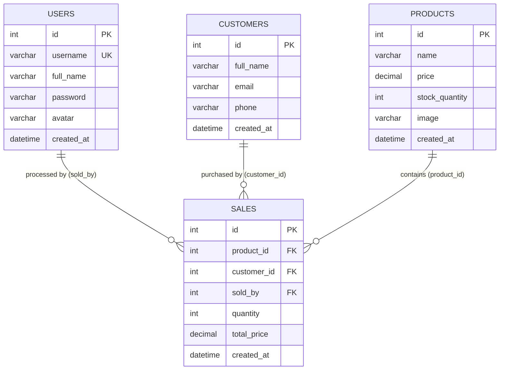

# THE COMPLETE POINT-OF-SALE SYSTEM

> **Four Beans Café — Web-Based Point-of-Sale (POS) & Inventory Management System**  
> Built with **Laravel 12 (PHP 8.2)**, **Bootstrap 5**, and **SQLite / MySQL**.

---

## 📋 Academic Project Information

| Field | Details |
| :--- | :--- |
| **Student Name / Group Name** | **Group 3** |
| **Section** | **TW35** |
| **Professor** | **Sir. Mar Eli Sagsagat** |

### Group Members & Project Roles

| Name | Role |
| :--- | :--- |
| **Amiel Azucena** | UI/UX Designer |
| **Jefferson Tan** | Documentation & QA Tester |
| **Andrei Klein Serrano** | Documentation |
| **Ann Valerie Camacho** | Full Stack Developer |

---

## ☕ Project Overview

**The Complete Point-of-Sale System** for **Four Beans Café** is a full-featured, responsive web application tailored for coffee shops, bakeries, and retail food establishments. Developed using the **Laravel** framework, the system streamlines daily café operations by replacing manual logbooks with an automated, computerized workflow.

### Core Objectives
- **Fast Cashier Checkout:** Expedite counter transactions with live stock checking and instant total calculation.
- **Accurate Inventory Tracking:** Automatically deduct product stock levels immediately upon sale, preventing overselling.
- **Staff Accountability:** Every transaction is tied to the logged-in staff member or cashier.
- **Customer Relationship Management:** Maintain customer records to support loyalty recognition and purchase tracking.
- **Actionable Business Analytics:** Provide real-time sales summaries, transaction tallies, and low-inventory warnings.

---

## ✨ Key Features & Modules

### 1. 📊 Executive Dashboard
- **Daily Performance Metrics:** Live KPI cards for Today's Revenue (₱), Total Transactions, Active Menu Items, and Registered Customers.
- **Low Stock Alerts:** Automatically highlights products with stock quantity ≤ 10 units to ensure timely restocking.
- **Recent Transactions Log:** Real-time table showcasing the latest 10 sales orders with cashier attribution, timestamp, and totals.
- **Quick Action Navigation:** One-click shortcuts to record a sale, adjust inventory, manage customers, or update staff.

### 2. 🧾 Point-of-Sale (Record Sale) Terminal
- **Dynamic Product Selection:** Select items from active inventory with live stock badges and unit pricing.
- **Customer Assignment:** Link orders to registered regular customers or process as standard walk-in/guest purchases.
- **Real-Time Validation:** Automatic validation preventing orders exceeding current stock levels.
- **Automatic Inventory Deduction:** Instantly decrements product quantity upon checkout confirmation (inside a DB transaction).

### 3. 📦 Product & Inventory Management (Full CRUD)
- **Menu Catalog:** Overview of all drinks, pastries, and merchandise with unit prices and remaining stock.
- **Add & Edit Products:** Add new items with customizable name, price, initial inventory, and product image uploads.
- **Stock Status Badges:** Visual indicators for *In Stock*, *Low Stock*, and *Out of Stock*.
- **Image Handling:** Automatic storage and replacement of uploaded product photos (`public/uploads/products/`).

### 4. 👥 Customer Management (Full CRUD)
- **Customer Directory:** Manage customer profiles including Full Name, Email Address, and Phone Number.
- **Order Association:** Connect customer profiles to sales transactions for customer history tracking.
- **Profile Updates & Deletion:** Edit customer contact information or remove outdated entries.

### 5. 🔐 Staff & Cashier Administration (Full CRUD)
- **Access Control:** Manage authorized staff members and cashier accounts.
- **Secure Password Hashing:** Credentials encrypted using Laravel's `bcrypt` hashing.
- **Profile Avatars:** Upload and update staff profile photos (`public/uploads/avatars/`).
- **Safety Protections:** Built-in safeguards preventing staff from deleting their own active logged-in accounts.

### 6. 📜 Sales History & Audit Logs
- **Complete Transaction Ledger:** Detailed records of every order completed in the system.
- **Comprehensive Details:** Displays Transaction ID, Date & Time, Cashier Name, Customer Name, Product Name, Quantity, and Total Amount (₱).

---

## 🛠️ Technology Stack

| Component | Technology | Description |
| :--- | :--- | :--- |
| **Backend Framework** | [Laravel](https://laravel.com/) 12.x | Modern PHP MVC framework |
| **Runtime** | PHP 8.2+ | With `intl`, `mbstring`, `curl`, `sqlite3`/`pdo_sqlite` (or `pdo_mysql`) |
| **Database** | SQLite (default) / MySQL | Relational database with foreign key integrity |
| **Frontend UI** | Bootstrap 5.3 & Bootstrap Icons | Responsive, mobile-ready layout with warm coffee-house aesthetics |
| **Templating** | Blade | Server-side view rendering |
| **Web Server** | PHP built-in server / Apache | `php artisan serve` for development |

---

## 🗄️ Database Architecture & Schema

Laravel database migrations create 4 interconnected tables (`users`, `products`, `customers`, `sales`):



---

## 🔑 Pre-Seeded Default Accounts

The `FourBeansSeeder` provides the following accounts:

| Username | Password | Full Name | Role / Access |
| :--- | :--- | :--- | :--- |
| `ann` | `admin123` | Ann Valerie Camacho | Administrator / Cashier |
| `amiel` | `amiel123` | Amiel Azucena | Staff / Cashier |
| `jefferson` | `jefferson123` | Jefferson Tan | Staff / Cashier |
| `andrei` | `andrei123` | Andrei Klein Serrano | Staff / Cashier |

---

## 🚀 Local Installation & Setup Guide

### Prerequisites
1. **PHP 8.2 or higher** (with `pdo_sqlite` or `pdo_mysql`, `mbstring`, `openssl`).
2. **Composer** (PHP dependency manager) — dependencies are already installed in `vendor/`.

---

### Step-by-Step Setup

#### 1. Place the Project
Copy the `Midterm-main` folder into your local web root (e.g. `c:\xampp\htdocs\Midterm`).

#### 2. Configure the Environment File (`.env`)
The default configuration uses **SQLite** — `database/database.sqlite` is already created and migrated.  
To use **MySQL** instead, edit `.env`:

```ini
DB_CONNECTION=mysql
DB_HOST=127.0.0.1
DB_PORT=3306
DB_DATABASE=fourbeansdb
DB_USERNAME=root
DB_PASSWORD=
```

#### 3. Run Migrations & Seed Default Data
```bash
php artisan migrate --seed
```

#### 4. Launch the Application
```bash
php artisan serve
```
Then navigate to: **`http://localhost:8080`**

#### 5. Log In
Use any of the pre-seeded credentials listed above (e.g. `ann` / `admin123` or `amiel` / `amiel123`).

---

## 📁 Project Directory Structure

```plaintext
Midterm-main/
├── app/
│   ├── Http/
│   │   ├── Controllers/
│   │   │   ├── AuthController.php        # Login, authentication & logout
│   │   │   ├── DashboardController.php   # Analytics, KPI counters, recent transactions
│   │   │   ├── ProductController.php     # Product catalog & stock inventory CRUD
│   │   │   ├── CustomerController.php    # Customer profiles CRUD
│   │   │   ├── StaffController.php       # Staff & cashier account administration CRUD
│   │   │   ├── RecordSaleController.php  # POS checkout logic & real-time stock deduction
│   │   │   └── SalesHistoryController.php# Sales ledger & transaction audit trail
│   │   └── Middleware/
│   │       └── PosAuth.php               # Route protection middleware (session check)
│   └── Models/
│       ├── Customer.php                  # Customer entity
│       ├── Product.php                   # Product entity
│       ├── Sale.php                      # Sales transaction model with joins
│       └── User.php                      # Staff/user authentication model
├── bootstrap/
│   └── app.php                           # Middleware alias registration (pos.auth)
├── database/
│   ├── migrations/                       # Schema migrations
│   └── seeders/
│       └── FourBeansSeeder.php           # Default users, menu items, customers
├── public/
│   ├── index.php                         # Front controller entry point
│   └── uploads/
│       ├── avatars/                      # Uploaded staff profile photos
│       └── products/                     # Uploaded product image files
├── resources/views/                      # Blade templates (same design as before)
│   ├── login.blade.php
│   ├── dashboard.blade.php
│   ├── products.blade.php
│   ├── customers.blade.php
│   ├── staff.blade.php
│   ├── record_sale.blade.php
│   └── sales_history.blade.php
├── routes/
│   └── web.php                           # Route definitions & auth-protected group
├── .env                                  # Environment & database configuration
└── artisan                               # Laravel CLI
```

---

## 📄 License & Attribution

This project is developed for educational purposes as part of the academic coursework for **TW35** under **Sir. Mar Eli Sagsagat**.
Built with [Laravel](https://laravel.com) under the [MIT License](LICENSE).
